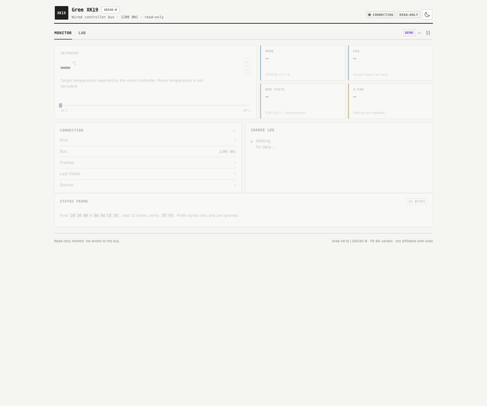

# Gree XK19 Protocol

**GRZ4E-B (2009) · XK19 wired controller · FE/BA variant · RS-485 1200 8N1 · read-only**


RS-485 reverse engineering for the GRZ4E-B indoor unit and a small read-only
dashboard for a Raspberry Pi.

Unofficial project. Not affiliated with or endorsed by Gree. See
[DISCLAIMER.md](DISCLAIMER.md).

Status: v0.1.0-readonly (2026-10-19).

What I can read today: setpoint, mode and actual fan level. What I cannot read:
room temperature, the X-FAN setting, or the auto/manual fan setting. I have not
managed to write to the unit through a parallel tap. A two-UART MITM bridge is
the next thing to try.

If your controller emits `7E 7E` frames, this is a different variant. My
captures contain zero `7E 7E` headers. The frames here are `FE` idle bytes plus
`BA AA CE 3E` / `E9 A6 CE 3E` payloads.

[中文说明](README.zh-CN.md)

## Scope

- In scope: read-only decoding, wiring notes and a local dashboard.
- Out of scope: vendor firmware, cloud/app protocol and write control. Write
  control is planned, not tested.
- Tested on one GRZ4E-B (2009) board. Other revisions may use different frames.

[Protocol](#protocol) · [Wiring](#wiring) · [Quick start](#quick-start) ·
[Dashboard](#dashboard) · [Contributions](#contributions)

## Current setup

The working setup is a Raspberry Pi 3 Model B+ with a CH340 USB-RS485 adapter
at `/dev/ttyUSB0`. I tap A/B and recommend adding AGND as the common-mode
reference. The 12V wire is never connected. No ESP32 is wired to this unit.

The ESP32/MITM material in this repo is a plan, not a verified installation.

| Phase | Hardware | Status |
|---|---|---|
| Current | Raspberry Pi 3 Model B+ + CH340 USB-RS485 | read-only |
| Next | ESP32 + two RS485 transceivers + bypass relay | planned, no ESP32 connected yet |

## What I can read

| Field | Status | Details |
|---|---|---|
| Setpoint | verified | `STATUS +6`, `(0xFE - byte) / 4`, 16–30 °C |
| Mode | mostly verified | cool, dry and fan captured live; heat and auto still need fresh captures |
| Fan level | mostly verified | `FA / F6 / F2` = 1 / 2 / 3; auto and manual look the same in steady state |
| Run state | experimental | `STATUS +7`; more than one value is still ambiguous |
| Room temperature | not decoded | no stable field found |
| X-FAN setting | not decoded | may live in the panel and only be sent on change or shutdown |
| X-FAN drying | low confidence | only seen around the post-shutdown `0xEE` frame |
| Write control | not achieved | parallel injection was rejected; ESP32/MITM is the next step |

I would not use this as a full climate integration yet. For a read-only view
of setpoint, mode and actual fan level on this older board, it works.

## Protocol


Serial settings are 1200 baud, 8 data bits, no parity, 1 stop bit. The frame is
variable length. The diagram marks the fixed and variable parts; the table
below names the fields.

### Status frame envelope

| Length | Part | Value |
| :---: | :--- | :--- |
| 0–4 bytes (optional) | prefix | `06 00`, `1A FF`, `CE 00`, `3A 60 06 02` … |
| 0 or 3 bytes | marker | usually `20 20 00`; some frames omit it |
| 12 bytes | payload | starts at `BA AA CE 3E`, ends at `7E F9` |
| 12–19 bytes | full frame | observed 15–17 bytes |

The payload is always the 12 bytes from `BA` to `F9`. The prefix and the
`20 20 00` marker are not part of the status.

### Status payload

| Offset | Bytes | Field | Example |
| :---: | :---: | :--- | :--- |
| `+0…+3` | 4 | signature | `BA AA CE 3E` |
| `+4` | 1 | type | `F2` |
| `+5` | 1 | mode | `74` = cooling |
| `+6` | 1 | setpoint | `96` = 26 °C |
| `+7` | 1 | run | `06` |
| `+8` | 1 | fan | `FA` = 1 |
| `+9` | 1 | flag | `BE` = cooling class |
| `+10…+11` | 2 | trailer | `7E F9` |

### Message examples

| Prefix | Marker | Payload | State |
| :--- | :---: | :--- | :--- |
| `06 00` | `20 20 00` | `BA AA CE 3E F2 74 96 06 FA BE 7E F9` | cool 26 °C, 1 fan |
| `1A FF` | `20 20 00` | `BA AA CE 3E F2 74 9A 0A FA BE 7E F9` | cool 25 °C, 1 fan |
| `3A 60 06 02` | none | `BA AA CE 3E F2 74 9E 06 FA BE 7E F9` | cool 24 °C, 1 fan |
| `06 00` | `20 20 00` | `BA AA CE 3E F2 F4 92 EE EC BE 7E F9` | off/standby 27 °C |

### E9 frame

| Length | Part | Value |
| :---: | :--- | :--- |
| 0–4 bytes (optional) | prefix | varies |
| 0 or 3 bytes | marker | `20 20 00` when present |
| 4 bytes | signature | `E9 A6 CE 3E` |
| 1 byte | type | `F2` |
| 1 byte | B5 | experimental, not a clean blow bit |
| 1 byte | B6 | experimental, drifts |
| 0–? bytes | tail | `FE …`; payload is 7–9 bytes after `E9` |

Examples:

| Full frame | Comment |
| :--- | :--- |
| `03 06 02 E9 A6 CE 3E F2 FC AC FE EE` | no marker |
| `20 20 00 E9 A6 CE 3E F2 0C 5A FE EE` | marker only |
| `5E FF 20 20 00 E9 A6 CE 3E F2 04 56 FE EE` | prefix and marker |

I scan for the signature and check the `7E F9` trailer. I do not split on every
`FE`: it can be the idle byte or a payload byte, and `STATUS +7` can be `FE` in
standby. Full details are in [docs/PROTOCOL.md](docs/PROTOCOL.md).

## Wiring

The XK19 cable has four wires. The silkscreen on this unit reads
`+12V B AGND A`, but the physical order can differ between revisions. Check it
with a meter; wire colors are not reliable.

| Wire | Use | Connect to USB-RS485? |
|---|---|---|
| `+12V` | panel supply from the indoor unit | no, tape it off |
| `AGND` | common ground | yes, to adapter GND |
| `A` | RS-485 A | yes |
| `B` | RS-485 B | yes |

The read-only tap is a 1-to-2 XHB splitter in parallel with the original cable.
Connect A and B, add AGND when possible, and leave 12V isolated. With correct
polarity the idle byte is `FE`; if you see `01`, swap A/B.

My current tap is A/B only. It works at 1200 baud on a short cable, but that is
not a good permanent setup. AGND is the signal reference, not the 12V supply.
Measure the voltage between adapter GND and panel AGND before connecting it.

For control, a 1-to-2 splitter is not enough. Break only A/B, keep 12V/AGND
continuous, insert two RS485 transceivers and add a normally-closed bypass
relay. No ESP32 bridge has been built on this unit yet.

Pinout, diagrams and relay contacts are in [docs/WIRING.md](docs/WIRING.md).

## Quick start

If you only want to see the UI, jump to step 2. For a real installation, wire
the read-only tap first.

### 1. Wire the read-only tap

Power off while making connections. Use the 4P 1-to-2 splitter between the
panel and its original cable. On the adapter branch, connect A and B, add AGND
when possible, and cover the 12V pin. Check the pin order with a meter before
plugging anything in.

After power-up, open the serial port at 1200 8N1. The idle byte should be `FE`.
If it is `01`, swap A/B.

More detail: [docs/WIRING.md](docs/WIRING.md).

### 2. Preview without hardware

```bash
python3 serve_demo.py
```

Open <http://localhost:8765/?demo=1>. It replays six snapshots from 2026-10-18.

`serve_demo.py --mock` uses the recorded current snapshot through the live-data
path. `serve_demo.py --source http://PI:8080` proxies a running Pi and is the
quickest way to compare this UI with the old one.

### 3. Run on the Pi

```bash
pip install -r requirements.txt
python3 pi_485_dashboard.py
```

Open `http://<pi-address>:8080/`.

### 4. MITM control

This part is planned, not tested. Read [docs/CONTROL.md](docs/CONTROL.md) and
[docs/WIRING.md](docs/WIRING.md) before cutting anything. Do not make the ESP32
the only control path until the bypass relay works.

## Why this board is annoying

Newer XK19 revisions use a `7E 7E` frame. My board does not emit it. A full
capture has zero `7E 7E` headers, and the field map that works on newer units
does not fit. Searching for "XK19" mostly lands on the newer variant.

I wrote this down because I could not find the `FE / BA` version anywhere.
Several earlier conclusions were wrong and were removed before publishing.

## The panel fights back

I tried injecting a setting into the parallel bus. It did not stick. After one
injection the bus produced a frame I had not seen in the baseline:

```text
4A 00 20 20 00 BA AA CE 3E F2 74 96 02 FA BE 7E F9
```

The status copy carries `+6 = 0x96` (26 °C), which is the panel's setpoint, not
the value I sent. I saw this once, so I treat it as a hypothesis: the panel is
the bus master and reasserts its own state. That is enough to make parallel
injection useless, but not enough to call it a complete correction protocol.

The next attempt is a two-UART MITM bridge. The idea is to sit between the
panel and the indoor unit, rewrite the outgoing frames, and keep a normally
closed relay across the cut so the panel still works if the bridge dies.

## How I got the field map

The field map came from a loop:

1. capture the whole bus;
2. change one panel setting;
3. diff the frames;
4. replay the capture offline;
5. check the conclusion on the live unit;
6. write down what is still unknown.

Things I got wrong:

- I thought the bus used a `7E 7E` header. It has none.
- I thought `E9 B5` was the blow switch. It changed in one 24 °C pair, then
  stayed at `04` while the panel was not blowing.
- I thought `E9 B6` was a stable run-state byte. It drifts during steady
  operation.
- I thought `F6 FA` carried room temperature. It jitters and does not track
  the setpoint.

The current protocol table only keeps what survived a live check.

## Home Assistant

The dashboard is for read-only monitoring:

- expose setpoint, mode, actual fan level and a diagnostic run state;
- do not use `+6` as room temperature; it is the setpoint;
- do not expose X-FAN as a switch, because the setting is not readable from
  the periodic frames;
- use an external room sensor for `current_temperature`.

## Project layout

```text
dashboard/              static Monitor + Lab frontend
docs/PROTOCOL.md        protocol reference and confidence table
docs/CONTROL.md         MITM plan (not built yet)
docs/WIRING.md          read-only tap and MITM wiring
docs/frame-layout.png   status + E9 frame layout
docs/dashboard.png      dashboard screenshot
pi_485_dashboard.py     Raspberry Pi HTTP server
serve_demo.py           local demo / mock / proxy server
requirements.txt        pyserial
LICENSE                 MIT for code and dashboard
DISCLAIMER.md           unofficial-project and trademark notice
```

## Dashboard

The dashboard is optional. I use it to check the current state without reading
the raw frames.



## What I am trying next

- Build the MITM pass-through and run it for a few days without rewriting.
- Rewrite the setpoint first, then mode and fan.
- Leave power alone until I have a separate off/on capture.
- Recapture heat and auto on this exact board.
- Capture X-FAN on/off through a full shutdown and drying cycle.
- Add golden-frame tests for the parser and decoder.

## Contributions

If you have the same board, open an issue with a raw capture, the panel state,
and the indoor-board revision. A single-variable capture is more useful than a
long log. Please do not send credentials or personal data.

## Safety and license

The `12V` wire can damage a Raspberry Pi or a USB-RS485 adapter. I only tap
A/B/GND. This is an unofficial project, not affiliated with Gree, and comes
with no warranty.

Code and the dashboard are MIT. Protocol documentation and screenshots are CC BY 4.0.
If you adapt text, images or code from elsewhere, keep the original license
and attribution.

Read the full [DISCLAIMER.md](DISCLAIMER.md) before using this on real
equipment.
