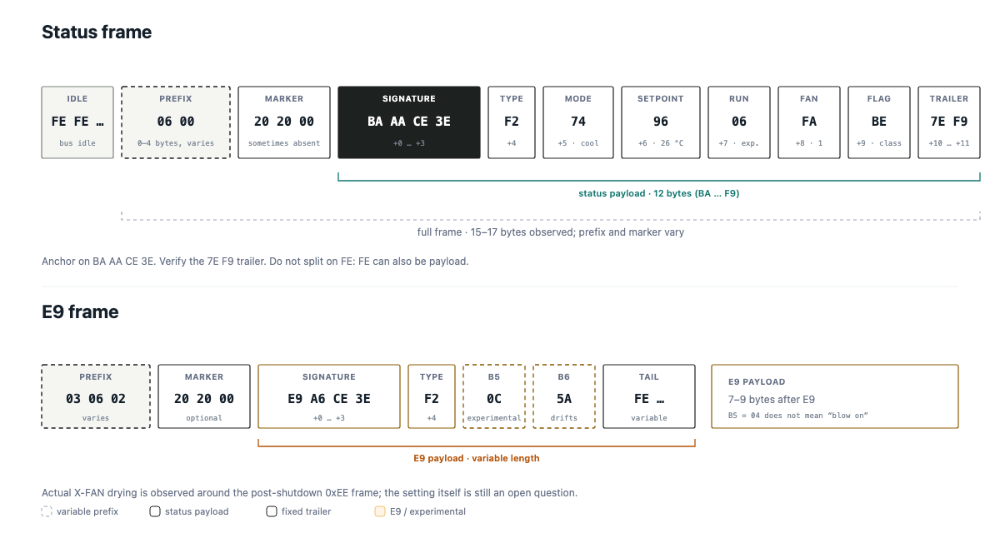

# Gree XK19 / GRZ4E-B Protocol

This is what I found about the `FE / BA-E9` variant on a 2009 `GRZ4E-B` indoor
unit with an XK19 wired controller. It is a different variant from the `7E 7E`
one used by newer XK19 revisions.

I mark each field as verified, experimental or unknown. Treat the experimental
rows as experimental; a few of them changed after a live test.

## 1. Physical layer

| Item | Value |
|---|---|
| Bus | RS-485, half duplex, two wires A/B plus GND |
| Controller supply | 12 V on a separate wire; do not connect it to the Pi |
| UART | 1200 baud, 8 data bits, no parity, 1 stop bit |
| Idle | long runs of `FE`; a single `FE` may also be payload |
| Direction | a single passive tap cannot tell which side sent a frame |

The adapter should be connected **in parallel** with the existing controller:
`A` to `A`, `B` to `B`, `GND` to `GND`. Leave `12V` unconnected. A/B polarity
matters; with this board the idle byte is `FE` when the polarity is correct.

The captures in this repository were taken with a Raspberry Pi 3 Model B+ and
a CH340 USB-RS485 adapter using automatic direction control. The adapter
appears as `/dev/ttyUSB0`; no GPIO direction pin is needed. If your adapter has
manual `DE/RE` pins, tie them for receive-only operation.

## 2. Framing



The diagram marks the fixed and variable parts of the frame. The table below
names the fields.

There is no `7E 7E` header and no XOR/CRC byte in the observed traffic.

| Length | Message part | Value |
| :---: | :--- | :--- |
| 0–4 bytes (optional) | Prefix | varies: `06 00`, `1A FF`, `CE 00`, `3A 60 06 02` … |
| 0 or 3 bytes | Marker | usually `20 20 00`; some frames omit it |
| 12 bytes | Payload | starts at `BA AA CE 3E`, ends at `7E F9` |
| 12–19 bytes | Full frame | observed 15–17; depends on prefix/marker |

The prefix and marker are not part of the status payload. Observed examples:

```text
06 00 20 20 00 BA AA CE 3E ...
1A FF 20 20 00 BA AA CE 3E ...
CE 00 20 20 00 BA AA CE 3E ...
3A 60 06 02 BA AA CE 3E ...      no 20 20 00 marker
BA AA CE 3E ...                   signature at the start of the buffered frame
```

Do not key the parser on a fixed prefix, and do not require `20 20 00` to be
present. The reliable anchor is `BA AA CE 3E`; read 12 bytes and verify the
`7E F9` tail.

### Why not split on FE?

`FE` is the idle byte, but it is also a valid payload byte. In
particular, `STATUS +7` can be `FE` while the unit is in standby. A parser
that splits on every `FE` will cut a status frame in half.

Use runs of `FE` only as a hint, and always resynchronise on:

```text
BA AA CE 3E
```

`20 20 00` immediately before the signature is a useful confidence boost, but
it is not guaranteed (see the `3A 60 06 02` example above).

## 3. Status frame

The status payload is 12 bytes, starting at `BA` and ending at `F9`:

```text
BA AA CE 3E F2 M T R F L 7E F9
```

| Offset | Field | Meaning | Confidence |
|---|---|---|---|
| `+0..+3` | signature | `BA AA CE 3E` | high |
| `+4` | type | observed `F2` | high |
| `+5` | mode | mode byte, needs `+9` | medium |
| `+6` | setpoint | `(0xFE - value) / 4` | high |
| `+7` | run state | experimental | low |
| `+8` | fan level | `FA / F6 / F2` = 1 / 2 / 3 | medium |
| `+9` | mode class | `BE` cooling class, `7E` heating/auto class | medium |
| `+10..+11` | trailer | fixed `7E F9` | high |

### Full frame examples

The prefix is included below so you can see how the same 12-byte payload is
reused by different poll/command frames.

| State | Full frame |
|---|---|
| Cool, 26 °C, 1 fan | `06 00 20 20 00 BA AA CE 3E F2 74 96 06 FA BE 7E F9` |
| Cool, 25 °C, 1 fan | `1A FF 20 20 00 BA AA CE 3E F2 74 9A 0A FA BE 7E F9` |
| Cool, 24 °C, 1 fan | `3A 60 06 02 BA AA CE 3E F2 74 9E 06 FA BE 7E F9` |
| Off / standby, 27 °C | `06 00 20 20 00 BA AA CE 3E F2 F4 92 EE EC BE 7E F9` |
| E9 frame | `03 06 02 E9 A6 CE 3E F2 0C 5A FE EE` |

The 17-byte examples have a 2-byte prefix + 3-byte marker. The 24 °C example
is 16 bytes: a 4-byte prefix and no marker. The status payload itself is always
the 12 bytes beginning at `BA`. The E9 payload after `E9` is variable length.

### Setpoint

```text
setpoint_celsius = (0xFE - byte_at_plus_6) // 4
```

Controlled checks are recorded at 16, 24, 25, 26, 28, 29 and 30 °C; the live
re-check on 2026-10-18 covered 25–27 °C. A controlled change from 26 to 27 °C
changed `+6` from `0x96` to `0x92` while `+5`, `+7`, `+8` and `+9` stayed
unchanged.

### Mode

`+5` alone is not enough: auto and cool share the same mode byte. Use the pair
`(+5, +9)`.

| Mode | `+5` | `+9` | Evidence |
|---|---|---|---|
| Cool | `74` | `BE` | verified live |
| Dry | `6C` | `BE` | verified live |
| Fan | `64` | `BE` | verified live |
| Heat | `5C` | `7E` | reported, needs a fresh capture |
| Auto | `74` | `7E` | reported, needs a fresh capture |
| Off / standby | `F4` | `BE` | observed |

In auto mode the indoor unit may run in cool mode, which is why `+5` can look
like cool. `+9` is the class flag that separates auto/heat from cool/dry/fan.

### Fan level

| `+8` | Meaning |
|---|---|
| `FA` | 1 |
| `F6` | 2 |
| `F2` | 3 |
| `EC`, `E4`, `F4` | seen in idle/standby or other states; do not map to a level |

Auto fan and manual fan at the same actual level are byte-identical in steady
state. Do not try to infer “auto” from `+8`; it only reports the current
physical level.

### Run state

`+7` is useful as a diagnostic, not as a power switch.

| `+7` | Interpretation | Confidence |
|---|---|---|
| `02`, `06`, `0A`, `F2` | running | medium |
| `EE`, `EA`, `FE` | standby / idle / off | low |
| other | unknown | - |

The same `EE` value has been seen in “off” and “just started” captures. Treat
this field as experimental. `+5 = F4` is a better candidate for “panel is
off”, but it still needs a dedicated power-cycle test.

## 4. E9 frame

The other useful signature is:

| Length | Message part | Value |
| :---: | :--- | :--- |
| 0–4 bytes (optional) | Prefix | varies |
| 0 or 3 bytes | Marker | `20 20 00` when present |
| 4 bytes | Signature | `E9 A6 CE 3E` |
| 1 byte | Type | `F2` |
| 1 byte | B5 | experimental |
| 1 byte | B6 | experimental |
| 0–? bytes | Tail | `FE …` |

Examples:

```text
03 06 02 E9 A6 CE 3E F2 FC AC FE EE
20 20 00 E9 A6 CE 3E F2 0C 5A FE EE
5E FF 20 20 00 E9 A6 CE 3E F2 04 56 FE EE
```

The payload after `E9` is variable length (7–9 bytes in the captures). The
first bytes look stable (`E9 A6 CE 3E F2`), but `B5` and `B6` are not a clean
blow switch.

Observed `B5` values include `04`, `0C`, `EC`, `F4` and `FC`. A 24 °C
controlled pair changed `FC AC` to `04 56` when blow was toggled, but later
live tests kept `B5 = 04` while the panel was not blowing. `B6` also drifts
continuously during steady operation.

I do not have enough evidence to call `B5` a blow bit. The working hypothesis
is that `B5` is a flags/setting byte, while the actual post-shutdown drying is
announced in an `0xEE` frame. That still needs a clean shutdown capture with
X-FAN on and off.

## 5. Other frames

### `72` frames

`72` frames contain a rolling byte and are not a temperature source. Early
notes interpreted them as setpoint or room temperature; that was wrong.

### `F6 FA` frames

`F6 FA` byte 2 jitters and does not track the setpoint. It is not a stable room
temperature. Do not expose it as one.

### `0x4A` frame

After a software injection, one capture contained:

```text
4A 00 20 20 00 BA AA CE 3E F2 74 96 02 FA BE 7E F9
```

It carries `+6 = 0x96` (26 °C), which is the wall controller's setpoint, not
the injected value. The `4A` frame was absent from the baseline. The working
interpretation is that the panel is the bus master and reasserts its own state
when it sees a command that did not originate from itself.

This is an observation plus hypothesis, not a fully characterised correction
protocol. The exact trigger, timing and scope still need controlled captures.
It is the reason parallel injection is not a viable control path; see
[CONTROL.md](CONTROL.md) for the MITM plan.

## 6. Parser rules

1. Scan for `BA AA CE 3E`; read 12 bytes and require `7E F9` at the end.
   Treat a preceding `20 20 00` as a confidence boost, not a requirement.
2. Scan for `E9 A6 CE 3E`; read a variable payload, at least through `B6`.
3. Do not split on every `FE`; `FE` can be data.
4. Do not assume a checksum; the trailer is constant, not a CRC.
5. Validate ranges: setpoint 16–30 °C, mode pair in the known table, fan in
   `FA/F6/F2` or unknown.
6. Require repeated frames or a short mode filter when showing a value; a
   single bit flip in `+6` changes the setpoint by 1–2 °C.
7. If you build a MITM bridge, use two UARTs and keep the wall→unit and
   unit→wall byte streams separate. A single tap cannot tell direction.

Minimal scan:

```python
STATUS = bytes.fromhex("ba aa ce 3e")
i = buf.find(STATUS)
while i != -1:
    if len(buf) >= i + 12:
        payload = buf[i:i + 12]
        if payload[-2:] == b"\x7e\xf9":
            yield payload
    i = buf.find(STATUS, i + 1)
```

## 7. Evidence

| Claim | Evidence | Confidence |
|---|---|---|
| 1200 8N1 | Repeated frames only at 1200; stable captures | high |
| `7E 7E` absent | Full captures contain zero `7E 7E` headers | high |
| No checksum | `7E F9` is constant; XOR is not zero | high |
| Setpoint formula | Controlled 26→27 change; 16–30 range | high |
| Cool/dry/fan pair | Live mode changes on 2026-10-18 | high |
| Fan 1/2/3 | Live fan changes; `FA/F6/F2` | medium |
| Heat/auto pair | Earlier captures, not replayed here | medium |
| Run state | Multiple captures, ambiguous `EE` | low |
| X-FAN setting | Contradictory captures; panel-local hypothesis | low |
| Room temperature | No stable field found | unknown |
| Write control | Direct injection rejected; MITM untested | unknown |

## 8. Open questions

- Does the X-FAN setting live in the panel and get sent only at shutdown, or
  is there a transient command we have not isolated?
- What exactly does `E9 B5` encode? It is not a simple on/off bit.
- Can the panel's `0xEE` drying frame be decoded reliably enough for HA?
- Are heat and auto still `5C/7E` and `74/7E` on this board?
- Can a MITM bridge rewrite wall→unit frames without the wall controller
  entering a correction loop?

## 9. Revision history

- **2026-10-18**: live verification of setpoint 26→27, cool/dry/fan mode
  changes, and the negative X-FAN result (`B5 = 04` while not blowing).
- Earlier conclusions that did not survive: `7E 7E` header,
  `E9 B5 = blow`, `E9 B6 = stable run state`, `F6FA = room temperature`.
