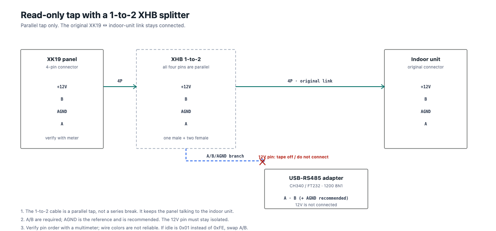
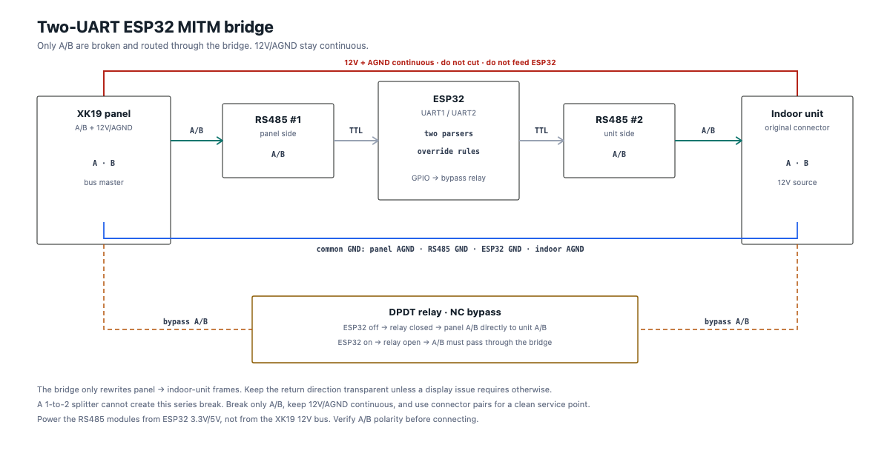

# Wiring

> **Status:** Section 1 (read-only tap) is the tested setup. Section 2
> (MITM bridge) is a **planned design**; no ESP32/dual-RS485 bridge has been
> built on this unit yet. Do not treat the MITM diagram as a validated
> installation guide.

There are two different wiring jobs:

1. Read-only tap: what a 1-to-2 XHB cable is for.
2. MITM control bridge: needs a real series break and two RS485
   transceivers; a 1-to-2 cable alone cannot do it.

## Pinout

The XK19 cable has four wires. The board silkscreen observed on this unit is
`+12V B AGND A`, but the physical order can differ between revisions. Verify
with a multimeter; do not trust wire colors.

| Wire | Use | Connect to USB-RS485? |
|---|---|---|
| `+12V` | panel supply from the indoor unit | no, tape it off |
| `AGND` | common ground | Yes, to adapter `GND` |
| `A` | RS-485 A | Yes, to adapter `A` |
| `B` | RS-485 B | Yes, to adapter `B` |

The bus is **1200 8N1**. With correct A/B polarity the idle byte is `FE`; if
you see `01`, swap A/B.

### Can it work with only A and B?

Yes, it can appear to work, especially at 1200 baud on a short cable. It is
not the recommended permanent setup.

RS-485 receivers still have a common-mode voltage range. With only A/B, the
two transceivers rely on an indirect ground reference: USB power, protective
earth, an isolated DC-DC converter, or leakage through the transceivers. That
can be fine on a bench, but it can produce intermittent frames, idle drift or
damaged transceivers when the reference moves.

`AGND` is the signal reference, **not** the 12V supply. For a non-isolated
adapter, connect it to the adapter `GND` after measuring:

```text
meter: adapter GND  ↔  XK19 AGND
DC volts: near 0 V  -> usually safe to connect
AC volts: significant -> stop; use an isolated adapter or fix the grounding
large DC offset -> do not connect directly; use an isolated transceiver
```

If the adapter is isolated, A/B-only may be acceptable, but confirm the
common-mode range of the module. For a MITM bridge, use a common ground unless
both bus sides are isolated; the ESP32 logic side still needs one reference.

## 1. Read-only tap with the 1-to-2 XHB cable



The 1-to-2 cable is a **parallel fan-out**: all pins on both female ends are
connected to the same male pins. It does not disconnect the original link, so
it is safe for a receive-only tap.

### Steps

1. Power the system down before making the connection. Do not work on the
   12V wire while it is live.
2. Identify the four wires with a multimeter. The pair with about 12V DC is
   `+12V`/`AGND`; the other two are `A`/`B`.
3. Check the connector gender and keying. Do not assume that the XHB pin 1
   matches the XK19 pin 1; buzz out each wire with a multimeter before
   connecting the adapter. A connector that physically fits can still have a
   different pin order.
4. Insert the 1-to-2 cable between the XK19 and its original indoor-unit
   cable:

   ```text
   XK19 ── 1-to-2 ── original cable ── indoor unit
                 └── adapter branch
   ```

5. On the **adapter branch**, connect `A` and `B`; add `AGND` to the adapter
   `GND` when possible. The `+12V` pin must be cut, taped off, or left out of
   the connector. Never feed 12V into a USB-RS485 adapter or the Pi.
6. Connect the adapter to the Pi/ESP32, open the serial port at 1200 8N1, and
   check the idle byte:
   - `FE`: polarity is correct;
   - `01` or garbage: swap A/B.
7. Leave the original panel↔indoor cable connected. This is a passive tap.

The splitter carries all four pins in parallel, including 12V. Label the three
branches (`panel`, `indoor`, `adapter`) and tape the 12V contact on the
adapter branch so it cannot touch anything.

### Do not use the tap for control

The 1-to-2 cable keeps the panel and indoor unit in parallel. If you inject a
setting into that parallel bus, the panel can reassert its own state with a
`0x4A` frame. That is why a tap is for reading only.

## 2. MITM bridge (planned, not yet built)



The MITM bridge is inserted **in series**:

```text
XK19 panel ── RS485 #1 ── ESP32 ── RS485 #2 ── indoor unit
```

### What to break

- Break **A and B only**.
- Keep `+12V` and `AGND` continuous; the panel still needs power.
- Do not use a 1-to-2 splitter as the bridge. It creates a parallel branch,
  not a series break.
- Use a male/female connector pair or a labelled service loop so you can
  restore the original wiring.

### Connections

| From | To | Details |
|---|---|---|
| Panel `A`/`B` | RS485 #1 `A`/`B` | panel side |
| RS485 #1 TTL | ESP32 UART1 | `RO`→RX, `DI`→TX; `DE/RE` if manual |
| ESP32 UART2 | RS485 #2 TTL | second UART, separate buffer |
| RS485 #2 `A`/`B` | Indoor `A`/`B` | indoor side |
| Panel `AGND` | RS485 #1 GND, ESP32 GND, RS485 #2 GND, indoor AGND | common ground |
| Panel `+12V` | Indoor `+12V` | **do not cut, do not feed ESP32** |

Power the RS485 modules from the ESP32's 3.3V/5V rail, not from the XK19 12V
bus. If a MAX485 module has a 5V `RO` output, use a divider or level shifter
before a 3.3V ESP32 RX pin.

### Fail-safe relay bypass

Use a **DPDT relay** or two normally-closed contacts:

- pole 1: panel `A` ↔ indoor `A`;
- pole 2: panel `B` ↔ indoor `B`;
- never short `A` to `B`;
- never switch the 12V wire with this relay.

Behavior:

- ESP32 off / unpowered / hung → relay releases → panel connects directly to
  the indoor unit;
- ESP32 booted → relay energises → the direct path opens → traffic must go
  through RS485 #1 → ESP32 → RS485 #2.

Do not make the ESP32 the only control path before the bypass relay is
installed and tested.

### ESP32 UART notes

- Use two hardware UARTs and two frame parsers; do not merge the two byte
  streams.
- On a WROOM-32, avoid the default UART1 pins GPIO9/10 (they are connected to
  flash). Remap UART1/UART2 to free GPIOs.
- At 1200 baud the byte rate is low; the hard parts are direction control,
  state reconciliation and the panel's periodic sync.

### Bring-up order

1. **Pass-through:** relay energised, no byte rewriting. Run for days; check
   that the panel and indoor unit still work.
2. **Setpoint only:** rewrite `STATUS +6`; test 16–30 °C and at least 100
   changes.
3. **Mode and fan:** rewrite `+5`/`+9` together; `+8` only for manual 1/2/3.
4. **Power:** only after a separate power-off/on capture.
5. **HA control:** expose a climate entity only after the hardware tests pass.

## Common mistakes

- Connecting the XK19 `+12V` to the Pi or USB-RS485 adapter.
- Using a 1-to-2 splitter as a MITM bridge.
- Cutting `+12V`/`AGND` instead of only `A`/`B`.
- Shorting `A` and `B` through the relay.
- Forgetting common ground.
- Running A/B-only for months and assuming it will stay stable.
- Swapping A/B and assuming the protocol is wrong.
- Adding several 120 Ω terminators at 1200 baud on a short cable.
- Putting 5V TTL into a 3.3V ESP32 pin.
- Merging wall-side and unit-side UART buffers.
